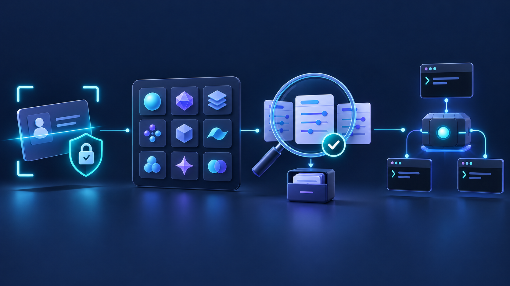
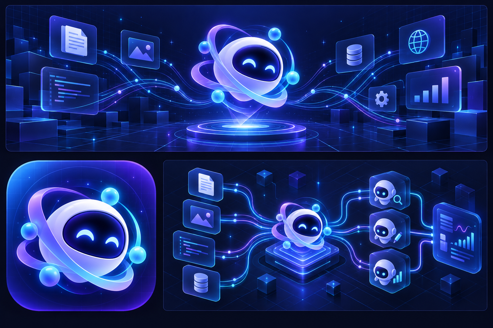
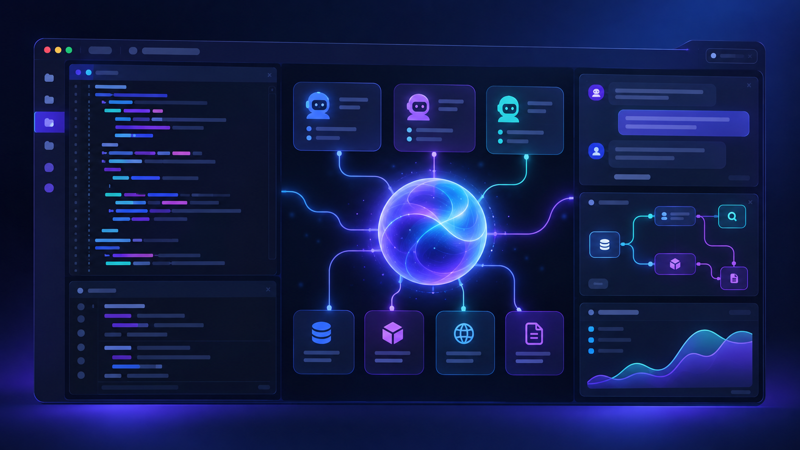

# WikiVibe Gateway для Orca


WikiVibe Gateway — самостоятельный плагин Orca для подключения провайдера WikiVibe к поддерживаемым CLI-агентам. Он проверяет API-ключ, загружает все доступные этому ключу модели и после предварительного просмотра и вашего согласия записывает провайдера, каталог и ключ в нативные конфигурации. Модель выбирается в самом агенте, а не в защищённой настройке. Форк Orca и изменение её параметров запуска не нужны.

**Версия — 1.1.9.** Настройка открывается во встроенном браузере Orca; защищённая страница показывает данные лимитов и расходов ключа. Живые данные в native sidebar пока недоступны: поддержанного канала worker → panel в Orca 1.4.223 нет.

## Визуалы проекта

Иллюстрации сохранены в [`assets/`](assets/). Новый баннер и визуал настройки сгенерированы моделью `gpt-image-2.5` через WikiVibe `/v1/responses` и записаны непосредственно в репозиторий. Ранее созданные оригиналы взяты из OMP-сессии `01a12b4e-ee58-751d-8721-98044dd8cbb2`. Это концепт-арт, не скриншоты работающего плагина и не техническая документация его архитектуры. Используемый в плагине логотип WikiVibe не заменён.




<details>
<summary>Галерея: обзор, схема и концепт интерфейса</summary>

### Обзор проекта



### Оркестрация AI-агентов


### Концепт интерфейса



</details>

Дополнительные оригиналы: [прежний баннер](assets/hero-banner.png), [квадратная иконка проекта](assets/project-icon.png) и [концепт favicon](assets/favicon-concept.png). Концепт favicon сохранён в исходном размере; как browser favicon он пока не подключён.


## Установка

В **Settings → Plugins → Install plugin → Git URL** укажите адрес версии 1.1.9:

```text
https://github.com/taranttoola-create/wikivibe-orca-plugin.git#v1.1.9
```

1. Откройте **Settings → Plugins** и включите **Plugin system**.
2. Выберите **Install plugin → Git URL**, вставьте адрес выше и установите плагин.
3. Проверьте разрешения: `secrets`, `storage`, `notifications:show`. Дайте согласие и включите **WikiVibe Gateway**.
4. После включения откройте правую панель Orca и выберите вкладку **WikiVibe**. В панели отображаются версия **1.1.9** и пошаговая инструкция запуска команд.
5. На Mac нажмите **⌘ J** — откроется окно **Jump to…** с поиском действий. Или нажмите вверху левой панели Orca **Search worktrees and browser tabs**.
6. В поиске введите **WikiVibe**, выберите нужную команду и нажмите **Enter**. Названия команд в боковой панели — это подсказки, а не кнопки.

Важно: версия 1.4.223 Orca показывает панели плагинов в правой панели, но её sandbox bridge не разрешает panel HTML читать `secrets` или вызывать worker-команды. Поэтому ключ вводится в защищённой локальной странице **во встроенном браузере Orca**, а не в правой панели или системном браузере. Страница использует encrypted `secrets`; панель Orca не просит вставлять ключ в небезопасный канал.
Логотип WikiVibe используется в заголовке панели и в metadata плагина. Присланный знак подготовлен как прозрачный PNG; в HTML панели и защищённой страницы он встроен через data URI, чтобы sandbox `srcDoc` не пытался загружать относительный файл. Декодирование PNG подтверждено во встроенном браузере Orca и sandbox `allow-scripts`. Вкладка правой панели использует встроенный значок Orca, потому что текущий API Orca не принимает изображение для `contributes.panels[].icon`.

Нужна Orca с plugin API 1. В manifest указана минимальная версия 1.4.214; panel manifest, panel sandbox и panel bridge проверены на Orca 1.4.223.

Репозиторий: [taranttoola-create/wikivibe-orca-plugin](https://github.com/taranttoola-create/wikivibe-orca-plugin). [Исходники версии 1.1.9](https://github.com/taranttoola-create/wikivibe-orca-plugin/tree/v1.1.9). [GitHub Release 1.1.9](https://github.com/taranttoola-create/wikivibe-orca-plugin/releases/tag/v1.1.9).

### Предыдущая версия 1.1.8

Сведения о предыдущем выпуске сохранены отдельно: [исходники v1.1.8](https://github.com/taranttoola-create/wikivibe-orca-plugin/tree/v1.1.8), [GitHub Release 1.1.8](https://github.com/taranttoola-create/wikivibe-orca-plugin/releases/tag/v1.1.8), [архив v1.1.8](https://github.com/taranttoola-create/wikivibe-orca-plugin/releases/download/v1.1.8/wikivibe.gateway-1.1.8.tar.gz). Для новой установки используйте только текущий Git URL `#v1.1.9` выше.

### Обновление уже установленного плагина

Повторите **Install plugin → Git URL** с полным адресом выше, заменив прежнее содержимое поля целиком. Тег закрепляет версию: повторная установка `#v1.0.2` не загрузит более новый релиз. Удалять плагин или вручную править хранилище Orca не нужно.

После успешной установки проверьте **WikiVibe Gateway · v1.1.9** в Settings → Plugins, подтвердите разрешения при запросе и включите плагин. В боковой панели также должна появиться версия **1.1.9**. Если диалог показывает **Orca could not fetch the pinned Git revision**, обновление не состоялось: старая копия остаётся установленной. Проверьте полный URL, `#v1.1.9` и доступ Git либо используйте локальную папку. Для обновления списков моделей повторите preview и применение к агентам, затем откройте новые сессии.

### Установка из локальной папки

Для установки версии 1.1.9 скачайте архив из [GitHub Release 1.1.9](https://github.com/taranttoola-create/wikivibe-orca-plugin/releases/tag/v1.1.9) и распакуйте его, либо выполните `npm run package:plugin` в исходниках. Выберите **Install plugin → Local folder** и укажите распакованную папку или `dist/wikivibe.gateway-1.1.9/`. Orca скопирует папку в своё хранилище; исходники Orca и параметры запуска не меняются. Убедитесь, что Settings → Plugins и sidebar показывают **1.1.9**, затем повторите preview и применение к агентам и откройте новые сессии.
Архив `dist/wikivibe.gateway-1.1.9.tar.gz` сначала распакуйте. Архив служит для передачи файлов, а не прямого импорта в Orca. Node.js и npm нужны для разработки и упаковки, но не для установки готовой папки.

## Где вводить ключ

После включения плагина:

1. На Mac нажмите **⌘ J**. Откроется окно **Jump to…**. Также его можно открыть кнопкой **Search worktrees and browser tabs** вверху левой панели Orca.
2. Введите **WikiVibe** и выберите **WikiVibe: Открыть WikiVibe и зарегистрироваться**. Команда откроет вкладку WikiVibe во встроенном браузере Orca; технический URL в боковой панели не показывается.
3. Для ключа выберите **WikiVibe: Открыть защищённую настройку**. В новой вкладке встроенного браузера Orca в блоке **API-ключ WikiVibe** выберите адрес API, вставьте ключ из личного кабинета и нажмите **Проверить и сохранить ключ**.
4. В той же странице проверьте каталог моделей, выберите агентов, просмотрите изменения и отдельно подтвердите добавление провайдера WikiVibe.
5. Запустите новую сессию выбранного агента. Агент не нужен для первоначальной настройки.

Ключ не вставляется в карточку агента Orca и не появляется в списке агентов: WikiVibe — API-провайдер для существующих агентов, а не отдельный harness.

## Подключение провайдера и каталога

1. Если аккаунта ещё нет, нажмите **Открыть WikiVibe и зарегистрироваться** на защищённой localhost-странице или выполните команду регистрации в Orca.
2. Выберите **Адрес API**: `https://api.wikivibe.dev/v1` или `https://vapi.wikivibe.dev/v1`. Введите **API-ключ** и нажмите **Проверить и сохранить ключ**.
3. Плагин выполнит `GET /v1/models` с Bearer authentication и сохранит ключ в зашифрованном хранилище Orca после успешной проверки. Сохранённый ключ не возвращается в браузер. Каталог берётся только из ответа для этого ключа: общий ключ получает весь свой доступный список, ограниченный — свой разрешённый список. Публичный marketplace не определяет доступ и не нужен для подключения.
4. Раздел каталога показывает модели для проверки, без выбора активной модели. При смене адреса обновите каталог и сохраните адрес провайдера.
5. Выберите новых агентов и нажмите **Посмотреть изменения**. Проверьте файлы и ограничения CLI. Первоначальная настройка требует разрешения записи ключа открытым текстом и кнопки **Применить к выбранным агентам**. Перед применением список заново запрашивается у API, чтобы не записать отозванный доступ.
6. В новой сессии агента выберите модель средствами самого CLI (см. таблицу ниже). Для CLI с provider picker выберите WikiVibe. Плагин не назначает активную модель и не перезаписывает пользовательский выбор; старые назначения плагина отменяются только для конфигураций, не изменённых после предыдущего применения.

После успешной проверки и сохранения ключа или адреса плагин автоматически синхронизирует credentials и authenticated catalog с агентами, ранее настроенными с вашим согласием. Сохранение ключа и результаты синхронизации показываются отдельно; ошибка одного агента не мешает остальным и не отменяет сохранение. Пользовательские правки вне управляемых блоков сохраняются, а restore не удаляет их. Новые агенты требуют отдельного просмотра и применения; простое обновление каталога файлы не меняет.

Команда **WikiVibe: Проверить подключение** проверяет доступ к каталогу. Ответ `/models` подтверждает доступ ключа к идентификаторам, но не совместимость с протоколом агента, streaming, tool calls или генерацию ответа. Включение модели в каталог не превращает модель изображений в чат-модель.

### Лимиты и расходы

Защищённая страница после подключения запрашивает [`GET /v1/usage?days=7`](https://api.wikivibe.dev/docs#limits) с сохранённым ключом. Показываются баланс аккаунта, источник оплаты, лимит/расход/остаток ключа, запросы, токены и расходы сегодня и за весь срок, доступные оконные лимиты. Расходы относятся **к этому ключу**, а не ко всем ключам аккаунта. Отсутствующие поля показаны как «Нет данных», нулевые значения сохраняются. Есть время получения и кнопка обновления; фонового polling нет.

Это дополнительная поверхность, не выполнение требования native sidebar. На Orca 1.4.223 panel bridge допускает только `workspace.readContext`, `terminal.sendText`, `notifications.show`; CSP содержит `connect-src 'none'`. Чтение storage и вызов worker из панели запрещены, изменение установленного HTML ломает content hash. Динамический sidebar требует поддержанного host transport; плагин не меняет Orca и не обходит sandbox/integrity.

Установленный 1.1.5 проверен через штатные Settings и native команды Orca: защищённая настройка, регистрация кнопкой и командой, сохранение отдельного реального ключа в OS-backed encrypted vault. После отключения и повторного включения только WikiVibe новый worker загрузил 15 моделей и свежие лимиты без повторного ввода ключа. Применение к Codex/OpenCode/OMP выполнено в установленной защищённой странице. Свежие OMP/OpenCode и Codex app-server с профильными overrides прочитали 15/15. Native `codex -p wikivibe` остановлен существующим `features.multi_agent_v2`; конфигурация не исправлялась. Inference не выполнялся.


## Поддерживаемые агенты

Все пути в таблице относятся к домашнему каталогу локального пользователя. Наличие агента в панели означает наличие адаптера конфигурации, а не обнаружение установленного CLI.

| Агент | Нативные файлы и выбор модели | Протокол / ограничение |
| --- | --- | --- |
| Claude Code | `.claude/settings.json`: gateway env и `modelPicker` со всеми ID; выбор через `/model` | Anthropic Messages, base URL без `/v1`. `modelPicker` требует Claude Code 2.1.242+. Отдельного именованного provider picker нет: gateway перенаправляет Anthropic transport. |
| Codex | `.codex/config.toml`: `[model_providers.wikivibe]`; `.codex/wikivibe.config.toml` и `.codex/wikivibe-models.json` | OpenAI Responses. Активируйте профиль нативно: `codex -p wikivibe`, затем `/model`. Корневой provider и модель не меняются. Orca должна запускать этот профиль средствами самого Codex; плагин не меняет запуск Orca. |
| OpenCode | `.config/opencode/opencode.json` или `.jsonc`: все существующие WikiVibe routes, полный каталог; `/models` | GPT — Responses через per-model `@ai-sdk/openai`; остальные — Chat Completions. Image output объявлен отдельно, tools выключены. |
| Pi | `.pi/agent/models.json`: providers.wikivibe и массив моделей; существующий `.pi/agent/settings.json`: расширение `enabledModels`; `/model` | OpenAI Chat Completions. Defaults сохраняются; scope получает `wikivibe/<id>`. |
| oh-my-pi | `.omp/agent/models.yml` или `.yaml`: WikiVibe endpoint/key и per-model api; `config.yml`/`.yaml`: фильтры | GPT — `openai-responses`, остальные — `openai-completions`. Image ID сохранены с `kind: image`, но OMP 18.6.3 игнорирует custom kind. `modelRoles` не меняются. |
| Aider | `.aider.conf.yml`: endpoint/key; `.aider.model.metadata.json`: все ID с `openai/`; `/models` и `/model openai/<id>` | OpenAI Chat Completions. Именованного WikiVibe provider picker нет; endpoint перенаправляет OpenAI transport. |
| Qwen Code | `.qwen/settings.json`: все модели в `modelProviders.openai`, env.WIKIVIBE_API_KEY; `/model` | OpenAI Chat Completions. WikiVibe отображается именами моделей внутри группы OpenAI, не отдельной группой протокола. |

Все 14 тестовых моделей подтверждены установленными OpenCode и oh-my-pi во временном HOME с исходными allowlist и запретом WikiVibe. Codex app-server ранее вернул две модели через `model/list` с provider/catalog overrides, эквивалентными файлу профиля; запуск профиля через TUI отдельно не проверялся. Для Claude Code, Pi, Aider и Qwen проверены файлы и контракты в тестах, не реальный запуск этих CLI. Coding inference не проверялся. Отдельный прямой запрос `gpt-image-2.5` к WikiVibe Responses успешно вернул PNG-изображения для этого README; это не проверка всех моделей или coding tools.

В 1.1.7 каталог OpenCode был ограничен доступом прежнего native credential (10 моделей). Начиная с 1.1.8 применение заменяет именно WikiVibe endpoint/key настройками плагина: authenticated `/models` этого маршрута содержит 15 ID, включая DeepSeek/Gemini/GLM. Реальные OpenCode2 и OMP прочитали все 15; OpenCode2 подтвердил per-model SDK и image output, OMP RPC выбрал `gpt-image-2.5` с `api: openai-responses` и без tools. Другие провайдеры и активные defaults сохранены. Эти проверки каталога и выбора transport выполнены без inference; отдельно подтверждена прямая генерация изображений `gpt-image-2.5` через Responses.

Существующие WikiVibe маршруты распознаются по HTTPS endpoint `api|vapi.wikivibe.dev|ru/v1`. Применение OpenCode/OMP заменяет прежние credentials и endpoint проверенными настройками плагина, сохраняя provider ID, комментарии вне изменяемого блока и metadata, не противоречащие transport. Все OpenCode routes на этих WikiVibe endpoint обновляются вместе, чтобы старые group credentials не оставались под другими именами. Другие провайдеры не меняются. Backups сохраняют точные исходные байты; синхронизация сохраняет последующие пользовательские правки вне управляемых блоков, а неоднозначные конфликты блокируют запись. Restore не перезаписывает сохранённые пользовательские правки.

Каталог Codex подтверждает backend/CLI, а не меню Desktop или Orca: [известно отдельное ограничение Desktop picker](https://github.com/openai/codex/issues/19694). У CLI, принимающего только один transport или профиль за сессию, установка каталога не создаёт переключатель между произвольными провайдерами.

**Image-модели — не coding-модели.** Ошибка `This model is not supported on the Chat Completions endpoint` для `gpt-image-2.5` возникла из-за отправки на `/chat/completions`. Теперь GPT отправляются через Responses. Это исправляет выбор endpoint, но не превращает image output в текст и tool calls. [OMP image tool](https://github.com/can1357/oh-my-pi/blob/main/docs/tools/generate_image.md) требует image-kind и hosted carrier. Установленный OMP 18.6.3 не читает custom `kind` из YAML, поэтому полного штатного image dispatch этой конфигурацией добиться нельзя. Codex принимает только Responses для agent model; его отдельный image tool использует `/images/generations` и `gpt-image-2`. Полный каталог сохранён, совместимость всех 15 моделей с каждым coding-agent не заявляется.

Codex 0.144.0 и 0.153.0 проверены: actual `-p wikivibe debug prompt-input`, native catalog и app-server `model/list` с эквивалентными профилю overrides прочитали все 15 моделей. Каталог включает обязательные поля обеих версий. В реальном пользовательском config исправлено `features.multi_agent_v2`: inline table заменена на boolean `true`; точные копии сохранены с правами 0600. Это локальный repair, не автоматическое изменение unrelated features плагином.

Ошибка `The current group does not support the requested model` означает отказ группы шлюза, а не неполное меню. Проверяйте authenticated `/models` на фактическом endpoint и с фактическим credential используемого провайдера. Добавление ID в JSONC не расширяет доступ. Для DeepSeek/GLM нужен маршрут с разрешающим их ключом/группой; плагин не меняет credentials или группу без согласия.

OpenCode 2.0.1 активирует плагины асинхронно: холодный `models --standalone` может вернуть пустой список до завершения активации. Runtime smoke ждёт штатный `/api/plugin/await-activation`, затем проверяет enabled WikiVibe и все 14 моделей через native API. В реальной сессии дождитесь загрузки каталога перед `/models`.

Плагин работает только со стандартными путями локального домашнего каталога. Профили Orca, `CLAUDE_CONFIG_DIR`, `CODEX_HOME`, `XDG_CONFIG_HOME`, конфигурации проекта, переменные окружения, managed settings и флаги CLI могут их переопределить. Настройки SSH/WSL и домашние каталоги удалённых агентов не меняются. Плагин не меняет параметры запуска Orca и не регистрирует новые harnesses через `contributes.agents`.

При применении существующий Claude `availableModels` получает raw ID из authenticated roster, Pi/OMP `enabledModels` — `wikivibe/<id>`. OMP `enabledProviders` и OpenCode `enabled_providers` получают `wikivibe`; из `disabledProviders`/`disabled_providers` удаляется только `wikivibe`. Порядок и остальные entries сохраняются, совпадающие ID не дублируются. Отсутствующие фильтры не создаются; пустые allowlist OMP остаются неограниченными. При обновлении новые additions строятся от исходного backup, поэтому отозванные ID плагина не остаются в фильтрах; исходные пользовательские ID сохраняются. Defaults и выбранная модель не меняются. Preview предупреждает об этих изменениях до согласия.

Cursor, Windsurf, Antigravity, Gemini и другие агенты без реализованного нативного адаптера автоматически не настраиваются. Поддержка файла конфигурации также не означает, что любая модель WikiVibe работает с соответствующим протоколом.

## Ключи, резервные копии и удаление настроек

Ключ плагина хранится через API `secrets` Orca с шифрованием средствами ОС. Адрес API сохраняется через `storage`; выбранной модели в настройках плагина нет.

В конфигурациях CLI ключ, напротив, записывается **открытым текстом**, только после явного согласия. Не публикуйте эти файлы и не добавляйте их в Git. На POSIX конфигурации и резервные копии получают права `0600`, каталог копий — `0700`. В Windows mode bits не заменяют NTFS ACL: доступ к профилю пользователя нужно ограничивать средствами ОС.

Резервные копии и записи восстановления находятся рядом с конфигурацией в `.wikivibe-gateway-backups/`. Копии могут содержать прежние секреты. Их тоже нельзя публиковать.

Чтобы отменить настройки, выберите нужных агентов, нажмите **Восстановить из резервных копий** и подтвердите действие. Плагин вернёт исходные байты и права файла либо удалит конфигурацию, которую создал сам. Если после применения файл меняли вручную, восстановление будет отклонено: сохраните свои изменения и сравните файл с копией вручную. Восстановление доступно и без сохранённого ключа. После него запустите новую сессию агента.

Применение и восстановление выполняются по файлам, а не одной общей транзакцией. При сбое часть файлов уже может быть изменена. Проверьте результат операции и восстановите выбранные конфигурации; записи незавершённых операций позволяют безопасно завершить восстановление.

Команда **WikiVibe: Удалить сохранённый ключ** и кнопка удаления ключа в панели удаляют только ключ из хранилища Orca. Конфигурации агентов не меняются, работающие сессии не отключаются. Если хотите убрать ключ из файлов агентов, сначала восстановите их из копий. Удаление самого плагина тоже не восстанавливает файлы автоматически. Чтобы отозвать ключ полностью, отзовите его в WikiVibe.

### Доступ плагина и локальная страница

Worker — доверенный Node-процесс с доступом к файловой системе и сети. Разрешения `secrets`, `storage`, `notifications:show` ограничивают host API Orca, но не создают изолированную среду ОС.

Обе команды открывают вкладки через публичный Orca CLI: `tab create --worktree all --url … --json`, затем `tab switch --page … --focus --json`. `all` здесь намеренно отключает привязку к cwd worker: установленная Orca создаёт вкладку в выбранном рабочем пространстве приложения. Требуются запущенная локальная desktop Orca, выбранное рабочее пространство и её доступный CLI. На macOS используется launcher из той же Orca.app, которая запустила worker. Внешний браузер и удалённый paired runtime не используются; при отказе команда сообщает об ошибке, а не о якобы открытой странице.

Панель слушает только `127.0.0.1`. Она требует случайный token из URL fragment и заголовка Authorization, проверяет Host/Origin, ограничивает размер JSON-запросов и запрещает iframe и внешние ресурсы через CSP. Token не хранится в cookies или localStorage и удаляется из адреса страницы. Не пересылайте URL настройки.

После перезагрузки вкладки нужно снова выполнить **WikiVibe: Открыть защищённую настройку**. Локальный сервер закрывается после четырёх минут бездействия. Orca также может остановить worker через пять минут после команды, даже при активной работе со страницей.

## Если что-то не работает

### Git URL не устанавливается

Используйте закреплённую версию:

```text
https://github.com/taranttoola-create/wikivibe-orca-plugin.git#v1.1.9
```

Orca принимает тег или полный 40-символьный SHA commit. Короткий SHA трактуется как имя ветки или тега и может привести к ошибке загрузки. Проверьте доступность полного репозитория `taranttoola-create/wikivibe-orca-plugin` и тега `v1.1.9`; не заменяйте тег сокращённым commit. Загрузка и checkout по полному SHA проверены отдельно от установки через Settings.

### «Не удалось выполнить команду плагина» на macOS

Версии до 1.1.5 искали публичный CLI внутри вложенного `Orca Helper.app`, через который Electron запускает worker. В 1.1.5 launcher разрешается относительно внешнего приложения Orca. Обновление выполняется через штатные Settings; менять launcher, sandbox или файлы установленной Orca не нужно.


### Панель потеряла связь или требует открыть её заново

Повторно выполните **WikiVibe: Открыть защищённую настройку** в Orca. Перезагрузка страницы не восстанавливает token. Закрытие сервера после бездействия и остановка worker по его сроку жизни не означают, что сохранённый ключ или конфигурации агентов удалены.

### Ключ не сохраняется или каталог пуст

Проверьте ключ, выбранный адрес API и сеть. Если `/v1/models` не вернул моделей, провайдер нельзя применить: пустой каталог не подменяется публичным списком. После смены адреса обновите каталог и сохраните адрес.

В этой версии панель различает причины отказа без показа ключа или ответа API: отказ доступа (HTTP 401/403), лимит запросов (429), сетевую ошибку, некорректный каталог и ошибку хранилища Orca. При ошибке хранилища проверьте разрешения `secrets` и `storage` в Settings → Plugins. После любого отказа ключ нужно ввести заново; не отправляйте его в чат.

### Плагин отказался менять конфигурацию

Отказ защищает существующую конфигурацию от неоднозначного изменения. Поддерживаются JSON, OpenCode JSONC, простой YAML и ограниченный TOML. В частности:

- OpenCode JSONC поддерживается с сохранением комментариев вне изменяемого блока. Одновременные `opencode.json` и `opencode.jsonc` требуют ручного устранения неоднозначности.
- YAML с anchors, aliases, tags, merge keys, несколькими документами или табуляцией не меняется. Inline mapping в изменяемом участке тоже может вызвать отказ.
- Сложный TOML, в том числе многострочные строки и неоднозначные ключи provider, автоматически не переписывается.
- Если у oh-my-pi одновременно есть `.yml` и `.yaml` для одного файла, устраните неоднозначность вручную. Старый `.omp/agent/models.json` плагин не мигрирует в YAML.
- Provider `wikivibe` на постороннем endpoint и существующие Qwen ID не перезаписываются. WikiVibe routes на доверенных endpoint, напротив, получают ключ/адрес плагина после согласия. Неправильные типы фильтров, сложные или path-scoped YAML-списки требуют ручной настройки.


Сверьте конфигурацию с документацией своей версии CLI и предупреждением панели. Для неподдерживаемого формата настройте агент вручную, не рассчитывая на автоматическое применение и восстановление плагином.

### Агент использует прежнюю модель

Сначала убедитесь, что после сохранения настроек вы применили их к агенту и запустили новую сессию. Затем проверьте профиль Orca, переменные окружения, настройки проекта и флаги CLI: они могут перекрывать файлы из таблицы. Ошибка запроса к модели требует отдельной проверки её протокола; наличие модели в каталоге недостаточно.

### После аварии осталась блокировка

Файл `~/.wikivibe-gateway.lock` защищает операции с конфигурациями. Не удаляйте его, пока worker или операция ещё работают. После полного отключения плагина можно вручную удалить оставшуюся блокировку и восстановить конфигурации.

## Разработка и проверки

Для разработки нужен Node.js 22 или новее и `npm ci`. Парсеры JSONC/YAML включены в `src/vendor`; runtime установки npm не требует. Пересборка: `npm run vendor`. Команды выполняются из корня исходников 1.1.9:

```sh
npm test
npm run check
npm run smoke
node scripts/smoke.mjs --fixture
node scripts/agent-smoke.mjs /absolute/path/to/opencode
node scripts/agent-smoke.mjs /absolute/path/to/omp omp
node scripts/worker-smoke.mjs '/Applications/Orca.app/Contents/Frameworks/Orca Helper.app/Contents/MacOS/Orca Helper' /Applications/Orca.app/Contents/Resources/app.asar.unpacked/out/main/plugin-host-entry.js
npm run package:plugin
```

Тесты конфигураций и smoke используют временный домашний каталог, не реальные конфигурации пользователя. `--fixture` предоставляет только проверочный каталог, не подмену API в рабочем плагине. `npm run smoke` проверяет отказ реального API неверному ключу. Agent smoke проверяет чтение конфигурации установленным CLI. Worker smoke запускает настоящий IPC worker установленной Orca с изолированным хранилищем и cwd вне проекта. Ему нужна открытая локальная Orca с выбранным рабочим пространством: через настоящий CLI он проверяет принадлежность созданных вкладок рабочему пространству, готовность авторизованной localhost-страницы, удаление token из адреса и загрузку страницы регистрации. Smoke закрывает только созданные им вкладки и не заменяет установку через Settings.

Проверены **72/72** поведенческих теста, включая save+sync ранее настроенных агентов, изоляцию отказов, сохранение пользовательских правок, OMP provider alias в фильтрах, замену старых WikiVibe credentials вместе с каталогом, mixed Responses/Chat routing, image metadata, конфликтную защиту и точное восстановление. Реальные OpenCode2/OMP прочитали 15 ID; Codex 0.144.0/0.153.0 приняли каталог и профиль. Два прямых запроса WikiVibe Responses к `gpt-image-2.5` завершились HTTP 200 / `completed` и вернули PNG, сохранённые как `gateway-banner.png` и `setup-flow.png`. Coding inference и штатный OMP image-tool dispatch не подтверждены.

### Упаковка и marketplace

`npm run package:plugin` создаёт папку `dist/wikivibe.gateway-1.1.9/` и архив. Для установки используйте Git URL `#v1.1.9`, Local folder или архив из [GitHub Release 1.1.9](https://github.com/taranttoola-create/wikivibe-orca-plugin/releases/tag/v1.1.9). Старый тег `#v1.1.0` не содержит исправления фильтров.

Для подготовки marketplace index выполните:

```sh
node scripts/marketplace.mjs https://github.com/taranttoola-create/wikivibe-orca-plugin.git v1.1.9
```

Сохраните JSON из stdout как `orca-marketplace.json` в своём marketplace-репозитории. Скрипт принимает URL и тег раздельно: в индексе `source.url` будет `https://github.com/taranttoola-create/wikivibe-orca-plugin.git`, а `source.ref` — `v1.1.9`. Это та же закреплённая версия, что и Git URL установки выше. Генерация индекса сама по себе не публикует плагин.

## Первичные источники

- [Orca Settings → Plugins](https://www.onorca.dev/docs/settings#plugins-experimental), [интерфейс установки плагина](https://github.com/stablyai/orca/blob/main/src/renderer/src/components/settings/PluginInstallDialog.tsx), [пример worker](https://github.com/stablyai/orca/tree/main/examples/plugins/hello-orca).
- [Claude Code: gateway](https://code.claude.com/docs/en/llm-gateway), [modelPicker](https://code.claude.com/docs/en/settings-reference#modelpicker).
- [Codex: справочник конфигурации](https://developers.openai.com/codex/config-reference).
- [OpenCode: конфигурация](https://opencode.ai/docs/config/), [providers](https://opencode.ai/docs/providers/).
- [Pi: конфигурация моделей](https://github.com/earendil-works/pi/blob/main/packages/coding-agent/docs/models.md).
- [oh-my-pi: модели](https://github.com/can1357/oh-my-pi/blob/main/docs/models.md).
- [Aider: OpenAI-compatible endpoints](https://aider.chat/docs/llms/openai-compat.html), [конфигурация](https://aider.chat/docs/config/aider_conf.html).
- [Qwen Code: аутентификация и конфигурация](https://qwenlm.github.io/qwen-code-docs/en/users/configuration/auth/).
